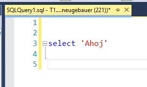
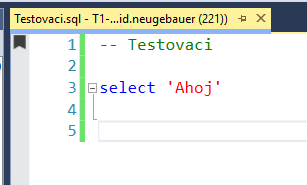
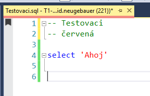

# SSMSTabManager – rozšíření pro SSMS 19

Rozšíření pro Microsoft SQL Server Management Studio 19. Neuložený dotaz (záložka `SQLQueryN.sql`) jedním příkazem uloží do nastavené složky (výchozí `%USERPROFILE%\.ssmstabmanager`, viz [Nastavení](#nastavení)) a pojmenuje ho podle prvního řádku. Záložka v SSMS pak nese tenhle název, takže se v otevřených záložkách líp vyznáš.

## Co dělá

Příkaz **„Uložit dotaz“** spustíš jedním z těchto způsobů:

- menu **Tools → Uložit dotaz**
- pravým tlačítkem na záložku dotazu → **Uložit dotaz**
- klávesová zkratka **Ctrl+Shift+Alt+S**

Příkaz pracuje s aktivní záložkou:

1. Když je dotaz **už uložený** (jeho soubor existuje mimo dočasnou složku `%TEMP%`):
   - Je uložený **mimo** cílovou složku: nic se nestane, dotaz zůstane, kde je, a zobrazí se o tom okno se zprávou.
   - Je uložený **v** cílové složce a první řádek začíná `--`: zobrazí se otázka Ano/Ne, jestli se má soubor přejmenovat podle prvního řádku (např. `2026-11-04_142529.sql` → `Vyčtení dat.sql`). Po potvrzení se dotaz uloží pod novým názvem, včetně neuložených změn. Záložka se přejmenuje a starý soubor se smaže. Když první řádek nezačíná `--`, zobrazí se zpráva. Když už název odpovídá prvnímu řádku, objeví se jen informace ve stavovém řádku (aby šlo příkaz spouštět i jen kvůli obarvení).

   Neuložené dotazy vede SSMS jako dočasné soubory `%TEMP%\~vsXXXX.sql`, proto se soubory v `%TEMP%` berou jako neuložené.
2. Když je dotaz **neuložený**, zkontroluje se **vždy jen první řádek**:
   - Když začíná `--`, název souboru je text za pomlčkami (bez data).
   - Jinak je název aktuální datum a čas ve tvaru `yyyy-MM-dd_HHmmss`.
3. Soubor se uloží do cílové složky. Pokud složka neexistuje, vytvoří se.
4. Záložka v SSMS se přejmenuje na název souboru.
5. Po úspěšném uložení se cesta k souboru zobrazí ve stavovém řádku SSMS dole. Chyby a situace, kdy se nic neuloží, se zobrazí v okně se zprávou.

Neuložený dotaz se záložkou `SQLQuery1.sql`:



Po doplnění `-- Testovaci` na první řádek a spuštění příkazu se dotaz uloží jako `Testovaci.sql` a záložka se přejmenuje:



### Příklady pojmenování

| První řádek dotazu          | Výsledný soubor                     |
|-----------------------------|-------------------------------------|
| `-- Vyčtení dat`            | `Vyčtení dat.sql`                   |
| `   --Vyčtení dat  `        | `Vyčtení dat.sql`                   |
| `----- Kontrola: A/B`       | `Kontrola_ A_B.sql`                 |
| `-----` (jen pomlčky)       | `2026-11-04_143512.sql`             |
| `SELECT * FROM t -- pozn.`  | `2026-11-04_143512.sql`             |
| prázdný řádek               | `2026-11-04_143512.sql`             |

Pravidla:

- Znaky, které Windows v názvu souboru nepovolují (`\ / : * ? " < > |`), se nahradí `_`.
- Název se zkrátí na 100 znaků.
- Když soubor se stejným názvem už existuje, připojí se čas (`Vyčtení dat_143512.sql`). Když existuje i ten, připojí se ještě pořadové číslo (`Vyčtení dat_143512_2.sql`). Existující soubor se nikdy nepřepíše.

## Obarvení záložky

Záložku jde obarvit dvěma způsoby.

### Z nabídky

Pravým tlačítkem na záložku → **Barva záložky** → **Červená / Zelená / Modrá / Žlutá / Fialová / Bez barvy**.

- Obarví se aktivní záložka (pravé tlačítko ji aktivuje).
- Když je 1. řádek název (`-- něco`), upraví se i 2. řádek, aby barva v textu odpovídala:
  - Pokud je na 2. řádku už barva (`-- modrá` apod.), přepíše se na novou.
  - Pokud tam barva není, vloží se nový 2. řádek `-- barva`. Původní 2. řádek se posune níž.
  - **Bez barvy** řádek s barvou smaže.
- Když 1. řádek název nemá, text se nemění, jen se obarví záložka.
- Dokument se tím změní, ale **neuloží**. Změnu jde vrátit přes Ctrl+Z. Po uložení zůstane barva v textu a po restartu SSMS ji vrátí příkaz **Uložit dotaz**.

Záložka po volbě **Červená** (vložený 2. řádek `-- červená`, dokument je neuložený):



### Automaticky při otevření souboru

Když se soubor otevře (okno dokumentu se zobrazí poprvé), rozšíření přečte první dva řádky. Pokud je tam název a barva (viz níže), záložku obarví samo. Nic se nekontroluje pravidelně, reaguje se jen na otevření dokumentu.

### Podle 2. řádku

Při každém spuštění příkazu **Uložit dotaz** a při otevření souboru se podle prvních dvou řádků nastaví barva záložky:

```sql
-- Testovací soubor
-- modrá
```

- 1. řádek musí být název (`--` a text, stejně jako pro pojmenování souboru).
- 2. řádek je barva: `-- červená`, `-- zelená`, `-- modrá`, `-- žlutá` nebo `-- fialová`. Diakritika ani velikost písmen nehrají roli.
- Když podmínka neplatí (chybí název, chybí barva, neznámá barva), barva záložky se nemění. Zůstane tedy i barva nastavená z nabídky. Odebrat ji jde přes **Barva záložky → Bez barvy**.
- Barva se nastaví i u dotazu, který se jinak neukládá ani nepřejmenovává (např. uložený mimo cílovou složku).
- Barva se nikde neukládá a záložky se průběžně nekontrolují. Po restartu SSMS ji vrátí otevření souboru. Po přesunutí záložky do jiné skupiny může zmizet a vrátí ji nové spuštění příkazu.
- SSMS nemá na barvu záložek oficiální API, rozšíření sahá do vnitřní struktury okna. Když záložku nenajde, ve stavovém řádku se objeví „záložku pro obarvení se nepodařilo najít“.

## Bookmark na prvním řádku

Když první řádek začíná `--` a za ním je text, příkaz při každém spuštění vloží na první řádek bookmark pojmenovaný podle tohoto textu (např. `-- Vyčtení dat` → bookmark `Vyčtení dat`). Bookmarky zobrazíš přes **View → Bookmark Window**.

- Bookmarky, které už na prvním řádku jsou, se nejdřív odstraní. Opakované spuštění tak nevytváří duplicity a po změně prvního řádku se bookmark přejmenuje.
- Bez `--` komentáře na prvním řádku se bookmark nevkládá.
- Název se nastavuje přes interní rozhraní editoru SSMS (`IVsBookmarkManager`). Když se nepodaří, bookmark zůstane bez názvu a ve stavovém řádku se objeví důvod.

## Jak rozšíření pracuje se SSMS (technicky)

### Načtení do SSMS

- SSMS 19 je postavené na shellu Visual Studia 2017 (verze 15.0) a rozšíření načítá stejným mechanismem jako Visual Studio: soubory `*.pkgdef`.
- Při startu SSMS projde složky uvedené v `PkgDefSearchPath` v souboru `Common7\IDE\ssms.pkgdef`. Mezi nimi je i `Common7\IDE\Extensions`, kam `install.bat` kopíruje složku `SSMSTabManager`.
- `SSMSTabManager.pkgdef` (generuje ho build z atributů v `SSMSTabManagerPackage.cs`) zaregistruje do konfigurace SSMS dvě věci:
  - **balíček** (`Packages\{699aba35-…}`): GUID, třídu `SSMSTabManager.SSMSTabManagerPackage` a cestu k DLL (`CodeBase`)
  - **menu** (`Menus`): odkaz na prostředek `Menus.ctmenu`, který vznikne při buildu z `SSMSTabManagerPackage.vsct` a je zabalený přímo v DLL. Definuje položky menu a klávesovou zkratku.
- Registry Windows ani nastavení SSMS se ručně nemění. SSMS si konfiguraci z `.pkgdef` sestaví samo. Soubor `extensions.configurationchanged` mu jen řekne, že ji má při příštím startu přepočítat.
- Balíček se načítá na pozadí **při startu SSMS** (`ProvideAutoLoad` pro kontexty `NoSolution` a `SolutionExists`, v `.pkgdef` sekce `AutoLoadPackages`). Musí totiž poslouchat otevírání dokumentů kvůli automatickému obarvení.

### Běh uvnitř SSMS

- `SSMSTabManager.dll` je knihovna pro .NET Framework 4.7.2 a běží **přímo v procesu `Ssms.exe`**. Žádný externí program ani skript se nespouští.
- Při buildu se kód kompiluje proti NuGet balíčkům Visual Studio SDK 15.0. Do instalace se ale nekopírují. Za běhu se volají **knihovny, které jsou součástí SSMS** (`Common7\IDE\PublicAssemblies` a `PrivateAssemblies`), například `envdte.dll` a `Microsoft.VisualStudio.Shell.15.0.dll`.
- Při prvním spuštění příkazu si balíček od SSMS vyžádá tyto služby (`GetServiceAsync`):

| Služba                      | K čemu se používá                                                  |
|-----------------------------|--------------------------------------------------------------------|
| `DTE` (EnvDTE)              | aktivní dokument, čtení textu, uložení, bookmark, stavový řádek     |
| `IMenuCommandService`       | napojení příkazu z menu a zkratky na metodu `Execute`               |
| `IVsUIShell`                | seznam otevřených oken dokumentů (pro obarvení záložky)             |
| `IVsRunningDocumentTable`   | textový buffer dokumentu (pro bookmarky)                            |
| `IVsTextManager`            | vstup ke správci bookmarků                                          |

### Jednotlivé funkce a použitá rozhraní

Ano, rozšíření volá metody z knihoven SSMS, a to na třech úrovních:

1. **Veřejné, dokumentované API** (EnvDTE, Visual Studio SDK). Je stabilní a používají ho všechna rozšíření VS.
2. **Reflexe na interní třídě.** Čte se vlastnost třídy, která není veřejná.
3. **Interní COM rozhraní.** Rozhraní, které SSMS interně používá, ale Microsoft ho nedokumentuje. Rozšíření si ho samo nadeklaruje podle GUID a pořadí metod.

| Funkce | Jak se provádí | Úroveň |
|--------|----------------|--------|
| čtení prvních dvou řádků | `Document.Object("TextDocument")` → `EditPoint.GetLines(1, 3)` | 1 |
| rozpoznání neuloženého dotazu | `Document.FullName`. SSMS vede neuložený dotaz jako dočasný soubor `%TEMP%\~vsXXXX.sql`, takže soubor v `%TEMP%` = neuložený | 1 |
| uložení / přejmenování | `Document.Save(cesta)` uloží dokument pod novou cestou a SSMS samo přejmenuje záložku. Při přejmenování se pak starý soubor smaže přes `File.Delete` | 1 |
| zprávy a dotaz Ano/Ne | `VsShellUtilities.ShowMessageBox`, stavový řádek přes `DTE.StatusBar.Text` | 1 |
| obarvení záložky | 1) `IVsUIShell.GetDocumentWindowEnum` vrátí okna dokumentů (`IVsWindowFrame`) a podle cesty se najde to aktivní. 2) Přes reflexi se přečte vlastnost `FrameView` interní třídy `WindowFrame`, tedy objekt, ke kterému je navázaná záložka. 3) Ve stromu WPF prvků okna SSMS (`VisualTreeHelper`) se najde prvek typu `DocumentTabItem`, jehož `DataContext` je tento objekt. 4) Jeho prvnímu prvku `Border` (rámeček celé záložky) se nastaví `Background` a `BorderBrush` (barva) a spodní `BorderThickness` (5 px pruh). Výška se nemění, nastavení `Height` záložku smrskne | 1 + 2 + vnitřní struktura WPF |
| obarvení při otevření | balíček se přes `IVsRunningDocumentTable.AdviseRunningDocTableEvents` přihlásí k událostem otevřených dokumentů. V `OnBeforeDocumentWindowShow` s `fFirstShow` přečte první dva řádky dokumentu (přes DTE) a obarvení odloží přes `Dispatcher.BeginInvoke(ApplicationIdle)`, protože prvek záložky v tu chvíli ještě nemusí existovat | 1 + obarvení výše |
| bookmark – buffer a staré bookmarky | `IVsRunningDocumentTable.FindAndLockDocument` → `IVsTextLines` → `EnumMarkers(MARKER_BOOKMARK)` na prvním řádku | 1 |
| bookmark – vložení | kurzor se přesune na 1. řádek a zavolá se nativní příkaz `DTE.ExecuteCommand("Edit.ToggleBookmark")` (Ctrl+K, Ctrl+K), pak se kurzor a výběr vrátí zpět. `EditPoint.SetBookmark()` se nepoužívá, protože bookmark vloží bez cesty k souboru (prázdná „File Location“) | 1 |
| bookmark – odstranění a název | služba `SVsTextManager` se přetypuje na interní `IVsPrivTextManager` → `GetBookmarkManager` → `IVsBookmarkManager.RemoveItem` (staré bookmarky), `GetCurrentBookmark` (právě vložený bookmark), kontrola `Line` a `Document` (prázdná cesta se toleruje), `IVsBookmarkItem.put_Text(název)` | 3 |
| bookmark – zobrazení názvu | `put_Text` změní název jen interně, okno Bookmarks (Win32 strom `SysTreeView32`) si drží vlastní kopii textu. `IVsBookmarkItem.GetItemHandle` vrátí `HTREEITEM` položky. Mezi stromy v procesu SSMS se najde ten, který položku obsahuje (průchod přes `TVM_GETNEXTITEM`), a text se přepíše přes `TVM_SETITEMW` | 3 + Win32 |

Interní COM rozhraní pro bookmarky jsou nadeklarovaná v `QueryBookmark.cs` (atributy `[ComImport]` a `[Guid]`):

| Rozhraní              | GUID                                   |
|-----------------------|----------------------------------------|
| `IVsPrivTextManager`  | `F584B25E-AC79-48AC-933F-CF285F8882A4` |
| `IVsBookmarkManager`  | `D9F127B8-5D54-418c-9399-E3A2D850D983` |
| `IVsBookmarkItem`     | `5B854029-17C5-4fb9-897A-16B40055EF51` |

GUID a pořadí metod jsou zjištěné reflexí z `Common7\IDE\PrivateAssemblies\Microsoft.VisualStudio.Editor.Implementation.dll` ze SSMS 19.1. U COM rozhraní záleží na pořadí metod (vtable), proto jsou v deklaraci uvedené i metody, které se nevolají.

### Kde se hodnoty drží

- **Soubory dotazů** se ukládají na disk do cílové složky a zůstávají tam trvale.
- **Barva záložky** se nastaví jen v paměti, jako lokální hodnota vlastností WPF prvku. Nikam se neukládá. Když SSMS záložku znovu vytvoří (restart, přesun do jiné skupiny), barva zmizí.
- **Bookmarky** spravuje SSMS samo, rozšíření je jen vytvoří a pojmenuje. Jestli je SSMS po restartu bez otevřeného solution/projektu zachová, není ověřené. Pravděpodobně ne, protože Visual Studio je ukládá do `.suo` souboru solution.

### Co může rozbít upgrade SSMS

| Část | Riziko | Projev |
|------|--------|--------|
| uložení, přejmenování, čtení řádků | nízké (veřejné API) | – |
| obarvení záložky | střední: změna interní třídy `WindowFrame` nebo šablony záložky | záložka se neobarví, ve stavovém řádku „záložku pro obarvení se nepodařilo najít“, nebo se obarví jiná část záložky |
| název bookmarku | vyšší: změna interního COM rozhraní | bookmark bez názvu, nebo okno „Chyba při ukládání“ s chybou rozhraní |
| načtení rozšíření | nové SSMS (21+) stojí na shellu VS 2022, 64bit | rozšíření se nenačte, je potřeba ho přestavět |

### Diagnostika

Kroky při vkládání bookmarku se vypisují do okna **View → Output**, panel **SSMSTabManager** (výběr v rozbalovacím seznamu „Show output from“).

## Ovládání `.bat` souborů

Všechny `.bat` soubory se spouštějí dvojklikem. Musí zůstat ve stejné složce jako `.ps1` skripty, které volají.

### `install.bat` – instalace

- Vyžádá si administrátorská práva (dialog UAC) a spustí `install.ps1`.
- Zkopíruje ze `src\bin\Release\` do `C:\Program Files (x86)\Microsoft SQL Server Management Studio 19\Common7\IDE\Extensions\SSMSTabManager\` tyto soubory:
  - `SSMSTabManager.dll` – kód rozšíření
  - `SSMSTabManager.pkgdef` – registrace balíčku a menu pro SSMS
  - `extension.vsixmanifest` – popis rozšíření
  - `SSMSTabManager.json` – nastavení (kopíruje se přímo ze `src\`, ne z `src\bin\Release\`)
- Aktualizuje čas souboru `...\Common7\IDE\Extensions\extensions.configurationchanged`, případně ho vytvoří. Tím SSMS při příštím startu pozná, že má znovu načíst rozšíření.
- Když SSMS právě běží, zobrazí varování a nic neudělá. SSMS má DLL rozšíření načtenou, takže ji nejde přepsat ani smazat. Nejdřív je potřeba zavřít **všechny** instance SSMS.
- Okno zůstane na konci otevřené, abys viděl výsledek.

### `uninstall.bat` – odinstalace

- Spustí `install.bat -Uninstall`, takže si taky vyžádá administrátorská práva.
- Smaže složku `...\Common7\IDE\Extensions\SSMSTabManager\`.
- Aktualizuje čas souboru `extensions.configurationchanged`.
- Uložené dotazy v cílové složce zůstanou beze změny.

### `build.bat` – sestavení

- Administrátorská práva nepotřebuje.
- Najde MSBuild z Visual Studia 2019 a zkompiluje projekt `src\SSMSTabManager.csproj` (Release). Při prvním buildu stáhne NuGet balíčky.
- Výstup uloží do `src\bin\Release\` (`SSMSTabManager.dll`, `SSMSTabManager.pkgdef`, `extension.vsixmanifest`, `SSMSTabManager.vsix`).
- Do SSMS nic nekopíruje. Po buildu je potřeba spustit `install.bat`.

## Postup instalace

1. Ulož rozpracované dotazy a zavři všechny instance SSMS.
2. Spusť `install.bat` a potvrď UAC.
3. Spusť SSMS, otevři **New Query**, na první řádek napiš `-- Test` a stiskni **Ctrl+Shift+Alt+S**.
4. Záložka by se měla přejmenovat na `Test.sql` a soubor by se měl objevit v `C:\Users\<uživatel>\.ssmstabmanager`.

Po úpravě kódu: `build.bat` → zavřít SSMS → `install.bat`.

## Změna klávesové zkratky

V SSMS otevři **Tools → Options → Environment → Keyboard**, vyhledej příkaz `Tools.SSMSTabManager` a přiřaď mu jinou zkratku.

## Obsah složky

V kořeni jsou skripty a README, zdrojové kódy a projekt jsou ve `src\`.

| Soubor                        | Účel                                                    |
|-------------------------------|---------------------------------------------------------|
| `build.bat` / `build.ps1`     | sestavení                                               |
| `install.bat` / `install.ps1` | instalace do SSMS                                       |
| `uninstall.bat`               | odinstalace ze SSMS                                     |
| `README.md`                   | tento popis                                             |
| `docs\images\`                | obrázky do README                                       |
| `src\SSMSTabManager.csproj`   | projekt (.NET Framework 4.7.2, VS SDK 15.0)              |
| `src\source.extension.vsixmanifest` | manifest rozšíření                                |
| `src\SSMSTabManager.json`     | nastavení (cílová složka)                                |
| `src\SSMSTabManagerPackage.cs` | balíček rozšíření, registruje příkaz                    |
| `src\SSMSTabManagerPackage.vsct` | umístění příkazů v menu, podnabídka barev, klávesová zkratka |
| `src\Commands\SSMSTabManagerCommand.cs` | logika příkazů (uložení, barva z nabídky, bookmark) |
| `src\Saving\QueryFileName.cs` | pojmenování souboru podle prvního řádku, řešení kolizí   |
| `src\TabColoring\TabColor.cs` | barva záložky podle druhého řádku                        |
| `src\TabColoring\TabColorizer.cs` | nalezení záložky v okně SSMS a nastavení barvy       |
| `src\TabColoring\DocumentOpenColorizer.cs` | obarvení záložky při otevření souboru       |
| `src\Bookmarks\QueryBookmark.cs` | pojmenovaný bookmark na prvním řádku                  |
| `src\Bookmarks\TreeViewRefresher.cs` | přepsání textu položky v okně Bookmarks (Win32 strom) |
| `src\Settings\ExtensionSettings.cs` | načtení nastavení ze `SSMSTabManager.json`         |
| `src\Properties\AssemblyInfo.cs` | název a verze sestavení                               |

## Nastavení

Nastavení je v souboru `src\SSMSTabManager.json`:

```json
{
  "targetDirectory": "%USERPROFILE%\\.ssmstabmanager"
}
```

- `targetDirectory` – cílová složka pro ukládání dotazů. Jde použít proměnné prostředí (`%USERPROFILE%`, `%OneDrive%` …). Zpětná lomítka se v JSON píšou zdvojeně (`"D:\\Dotazy"`). Když hodnota chybí nebo je prázdná, použije se `%USERPROFILE%\.ssmstabmanager`.
- `install.bat` soubor zkopíruje vedle DLL do `...\Common7\IDE\Extensions\SSMSTabManager\`. Rozšíření čte **tuto kopii**, a to při každém spuštění příkazu. Po úpravě v projektu tedy stačí zavřít SSMS a spustit `install.bat`. Build není potřeba.
- Když soubor v instalační složce chybí, použije se výchozí složka. Když je neplatný, příkaz skončí hláškou „Chyba při ukládání“ s popisem chyby.
- Přejmenování podle 1. řádku funguje jen u souborů přímo v cílové složce. Dotazy uložené ve staré složce se po změně nastavení berou jako uložené jinde.

## Požadavky

- SSMS 19 nainstalované ve výchozí cestě `C:\Program Files (x86)\Microsoft SQL Server Management Studio 19`
- pro build: Visual Studio 2019 s workloadem *Visual Studio extension development* a přístup na nuget.org

## Omezení

- Microsoft rozšíření v SSMS oficiálně nepodporuje. Po upgradu SSMS je potřeba ověřit, že rozšíření pořád funguje.
- Cesta k SSMS je napevno v `install.ps1`. Pro jinou verzi SSMS je potřeba ji upravit.
- Příkaz neukládá změny v už uložených souborech. Na to slouží běžné Ctrl+S.

## Řešení potíží

- **Příkaz se v menu Tools neobjeví:** zkontroluj, že jsou zavřené všechny instance SSMS, a spusť `install.bat` znovu.
- **Hláška „Dokument už je uložený“ u nového dotazu:** okno ukáže cestu k souboru. Pokud není v `%TEMP%`, je potřeba upravit, jak `IsSavedFile` v `SSMSTabManagerCommand.cs` pozná neuložený dotaz.
- **Hláška „Chyba při ukládání“:** text chyby je v okně se zprávou.
